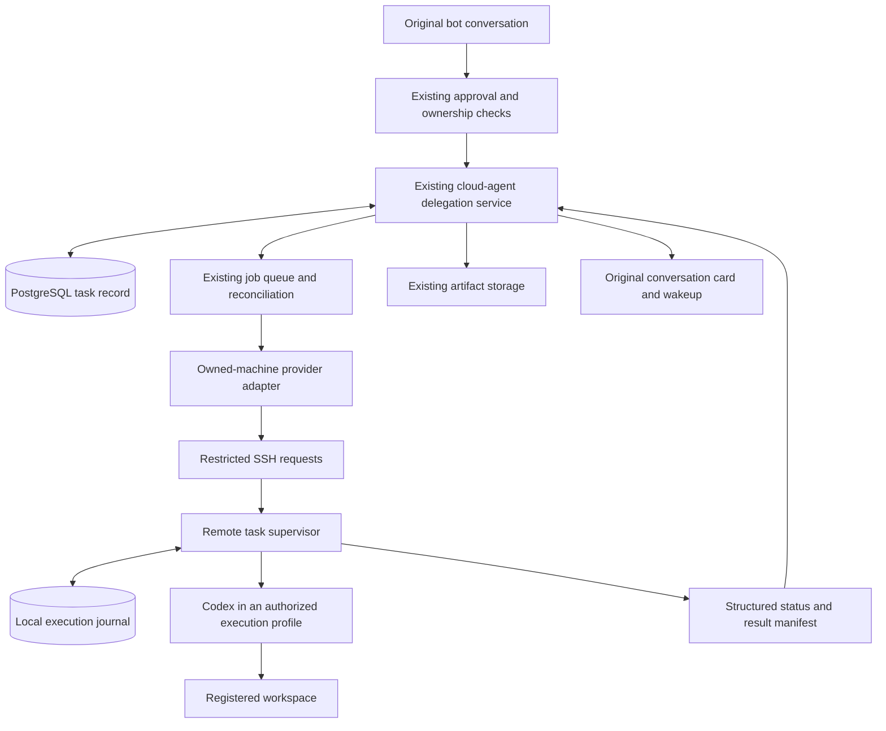

# Architecture proposal: native-agent delegation

Status: proposed design, not implemented. Prepared on 2026-11-11.

Source review baseline: [`12df02ee5989067a11396fa19f65b1cb340bc994`](https://github.com/elie222/rakazo/commit/12df02ee5989067a11396fa19f65b1cb340bc994). Proposed types and behaviors below are not claims about existing product capabilities.

[Interaction design and screenshots](interaction-design.md) · [Interactive prototype](prototype.html)

## User outcome and scope

A self-hosted user asks a Rakazo bot to analyze a project on a machine they own. An already configured native agent performs the task in an authorized execution environment. The original conversation shows progress, supports cancellation, and receives the result, including after a temporary connection or worker failure.

The first increment is deliberately bounded: one Linux host, one operator-registered workspace, one native runtime (Codex), restricted SSH, read-only tasks, and the owner's direct conversation. It includes configuration, launch, the chat card, cancellation, recovery, result delivery, documentation, and tests as one usable feature.

Workspace writes remain a follow-up until native approvals and enforced access boundaries are reliable. Runtime authentication stays on the execution host and uses supported authentication methods. Unknown subscription usage, quota, or cost remains unknown; there is no silent account or model-provider fallback.

## Relationship to upstream work

| Work | Relationship |
|---|---|
| [#464](https://github.com/elie222/rakazo/pull/464) | Reuse the existing cloud-agent delegation lifecycle, ownership, persistence, cancellation, cards, and completion wakeups. |
| [#2348](https://github.com/elie222/rakazo/pull/2348) | Relevant to a later outbound transport; preserve device ownership and session-revocation semantics. |
| [#3101](https://github.com/elie222/rakazo/pull/3101) | Useful precedent for background read-only work and compact task cards, but not a remote native runtime. |
| [#1479](https://github.com/elie222/rakazo/issues/1479) | Related BYO-host use case; this narrower proposal does not provide desktop provisioning or screen streaming. |
| [#1379](https://github.com/elie222/rakazo/issues/1379) | Primary-harness selection is separate: this proposal retains the current bot and explicit delegation. |

Later write approval should coordinate with related subagent approval work, including [#4035](https://github.com/elie222/rakazo/pull/4035), without assuming that an open proposal is an available dependency.

## Architecture



| Component | Responsibility |
|---|---|
| PostgreSQL | Authoritative authorization, task intent, target snapshot, cancellation request, conversation identity, result references, and wakeup deduplication. |
| Existing job queue and reconciler | Short remote requests and recoverable synchronization. No second central scheduler or notification service. |
| Remote supervisor and journal | Durable submission deduplication, process identity, workspace locks, cancellation tombstones, ordered events, and result recovery. |
| Native runtime | Execute the delegated task using its supported local authentication and restricted configuration. |
| Existing messages and artifacts | Render state and results under normal access control and retention. Treat native output as untrusted content. |

The local journal may use SQLite. It records execution on that host; it is not a competing source of central authorization or scheduling truth.

## Transport and registration

Start with fixed SSH registration because it avoids coupling the first execution feature to a new pairing and service-identity lifecycle. This limits the first increment to Linux hosts reachable from the Rakazo worker. NAT-bound laptops are a later increment.

Use a dedicated restricted key, verified host fingerprint, fixed destination and entry point, and JSON on stdin. Task text must never become shell command syntax. No agent forwarding, user-supplied executable paths, arbitrary environment variables, or model-selected SSH destinations.

The deployment must document and validate SSH availability in the actual worker image, along with read-only credential mounts. A working development-machine command is insufficient.

The first target can be operator configuration rather than a new management UI:

```ts
type ExecutionTarget = {
  id: string;
  ownerUserId: string;
  spaceId: string;
  allowedBotIds: string[];
  revision: string;
  runtime: "codex";
  workspaceLabel: string;
  workspaceRef: string;
  access: "read-only";
  transportRef: string;
};
```

The model receives an authorized target reference, not arbitrary `cwd`, credentials, or CLI flags. Resolve and pin the target revision, runtime profile, workspace identity, and permissions at launch. Configuration edits must not redirect an existing job to a different host. Revocation still blocks new execution and access; an offline host cannot acknowledge immediate termination.

## Additive integration with existing delegation

| Existing boundary | Proposed addition |
|---|---|
| `CloudAgentLaunchRequest` | Optional target reference, resolved server-side into an immutable authorized binding. Keep the current repository semantics for existing providers. |
| Provider capabilities | Explicit support for workspace jobs and structured results. Set `reply=false` until real native-session continuation is implemented. |
| Snapshot and card | Execution phase, connectivity, structured reasons, and result references. A native task should not need a fabricated web or PR URL. |
| Connection factory and reconciler | Owner and target constraints for the native provider, while retaining current providers and scheduling behavior. |
| Existing task record | Only the additive target, phase, and result-delivery fields consumed by this feature. |

The reviewed factory resolves one deployment-level connection. The first increment should respect that limitation rather than introducing a general registry for multiple providers and owners. Broad renaming of `CloudAgent*` is not a prerequisite.

## Remote execution contract

| Operation | Semantics |
|---|---|
| `submit(jobId, payloadHash, profileRevision, task)` | Persist acceptance before execution. Same ID and content resolves to the existing record; changed content with the same ID is rejected. |
| `status(jobId, afterSequence)` | Side-effect-free lookup returning ordered execution events, process state, and result metadata. |
| `cancel(jobId, cancellationId)` | Idempotent request; persist a tombstone even if cancellation arrives before submission. |
| `result(jobId, cursor)` | Bounded output for this task only, not arbitrary file download. |
| `capabilities()` | Check supported protocol/runtime versions, authentication readiness, and enforceable restrictions. Connectivity alone does not prove execution works. |

Stable IDs and ordered events support at-least-once delivery without duplicate task acceptance. They do not guarantee exactly-once effects across arbitrary shell commands, remote services, or model tool calls.

## Recovery and cancellation

Execution state, connectivity, and result delivery are separate dimensions. Preserve existing lifecycle values where practical, with additional phases such as queued, executing, cancelling, and uncertain. Result delivery can be pending, ready, or unavailable.

| Failure or race | Required behavior |
|---|---|
| Accepted submit with a lost response | Reconcile the same job ID; never generate a new job to retry uncertain execution. |
| Crash between journal update and process creation | Continue only when non-execution can be established; otherwise keep the task uncertain and retain its workspace lock. |
| Worker restart or lease expiry | Existing database fencing lets a worker take over observation; lease expiry does not release the remote workspace lock. |
| Missing journal after host failure | Missing is not proof of non-execution. Require reconciliation rather than treating it as safe to launch again. |
| Cancellation races with completion | Preserve the confirmed actual outcome. Cancellation is not rollback, and completed work must not be relabeled as never executed. |

Native unknown-record conditions must not map to ordinary provider `not_found` handling. Existing provider-specific assumptions about follow-up settlement must not cause native work to be resent. Preserve the current providers' behavior and regression tests.

Cancellation targets only this task's process tree, with process-start identity checks rather than a reusable PID or a global process name. Writable execution additionally requires supervision that covers spawned processes. Environments unable to enforce that boundary must not advertise reliable writable execution.

Workspace locks use canonical resource identity and account for path aliases, symlinks, and shared repository metadata. Concurrency is scoped to the host/workspace and authorization context, not an arbitrary deployment-wide limit.

## Result delivery

Reuse the existing transaction, original-thread/message checks, membership checks, bot state, and generation-based wakeup. Persist result artifacts before recording their references as available. Upload retries must not rerun the task; use stable artifact identity and normal orphan cleanup.

If execution ends before the result arrives, show **Execution finished · Result pending**. Wake the original bot when the result is durable, or when a clear terminal explanation of unavailable results has been recorded. The wakeup contains locally generated task identity and status; native text is read separately as untrusted tool output.

Bound output size, preserve truncation information, and avoid exporting authentication files or full environments. Clearing the conversation, removing its owner, or archiving its bot must prevent stale delivery or recreation of deleted cards. Check both human access and the originating bot/thread context when serving results.

## Filesystem and approval boundaries

**A working directory is not confinement. Read-only execution does not automatically restrict which files can be read.** Declare and validate readable paths, writable paths, network access, runtime configuration, and execution identity separately.

The reference profile must enforce its declared boundary or reject the configuration. If only write restrictions are available, use an explicitly authorized dedicated environment and describe its actual read scope; do not claim project-only access. Native login remains local, but this alone does not isolate authentication files from tool subprocesses.

Pin reviewed runtime configuration and versions. Repository hooks, plugins, MCP servers, and inherited environment settings must not silently widen the approved scope. Unsupported native permission requests fail closed with structured reasons rather than natural-language keyword detection or bypass flags.

For later writes, bind each approval to the job, target revision, native request ID, exact operation/scope, and expiry. Reject stale, duplicate, cross-task, or post-revocation approvals. Agree on the mapping to Ask/Auto/Never ask; a launch approval must not silently become unrestricted approval for every future native action.

An offline process cannot be stopped instantaneously. Writable execution may require a locally enforced authorization lease and termination grace period. Reconnection means recovering the original task record, state, and result; it is not a promise of seamless native-process or session continuation.

## PR sequence and validation

| Increment | Complete usable capability | Acceptance |
|---|---|---|
| First | Native read-only analysis in an owned Linux workspace | Configuration, launch, card, confirmed cancellation, same-job recovery, result delivery, cross-client presentation, docs and tests. |
| Second | Approved workspace edits | Native approval mapping, enforced paths, process-tree control, locks, revocation, and visible partial changes. |
| Third | Outbound enrollment and reconnection | Pairing, scoped identity, rotation, revocation and sign-out semantics, preserving durable job identity. |

Add another runtime or a multi-target UI when a concrete use case requires it. Each increment includes its own usable flow; do not submit unused tables or routes as a prerequisite-only PR.

CI should use deterministic native-process fixtures, the provider emulator, and temporary PostgreSQL. Cover duplicate acceptance, crash windows, cancel-before-submit, competing workers, lost responses, authorization boundaries, removed conversations, output limits, result persistence, and completion deduplication.

An opt-in live test must read a known project file through a real Codex task and return the verified result to its original conversation. Reconnection and cancellation must be exercised separately. Later writes require positive and negative filesystem and approval tests. Browser-responsive checks do not establish native mobile parity.

Use additive migrations and capability-aware rollout. Old workers must not consume native jobs they cannot understand. Disable new submissions and reconcile existing jobs before rollback; preserve the records required for recovery.

## Source pointers

The review examined the [provider contract](https://github.com/elie222/rakazo/blob/12df02ee5989067a11396fa19f65b1cb340bc994/packages/adapter-kit/src/types.ts#L1348-L1393), [delegation service](https://github.com/elie222/rakazo/blob/12df02ee5989067a11396fa19f65b1cb340bc994/packages/adapters/src/cloud-agent-service.ts), [factory](https://github.com/elie222/rakazo/blob/12df02ee5989067a11396fa19f65b1cb340bc994/packages/adapters/src/cloud-agent-factory.ts), [polling and wakeup](https://github.com/elie222/rakazo/blob/12df02ee5989067a11396fa19f65b1cb340bc994/packages/adapters/src/cloud-agent-poll.ts), [device session handling](https://github.com/elie222/rakazo/blob/12df02ee5989067a11396fa19f65b1cb340bc994/apps/api/src/user-devices.ts), and [approval rules](https://github.com/elie222/rakazo/blob/12df02ee5989067a11396fa19f65b1cb340bc994/packages/core/src/action-approval.ts).
