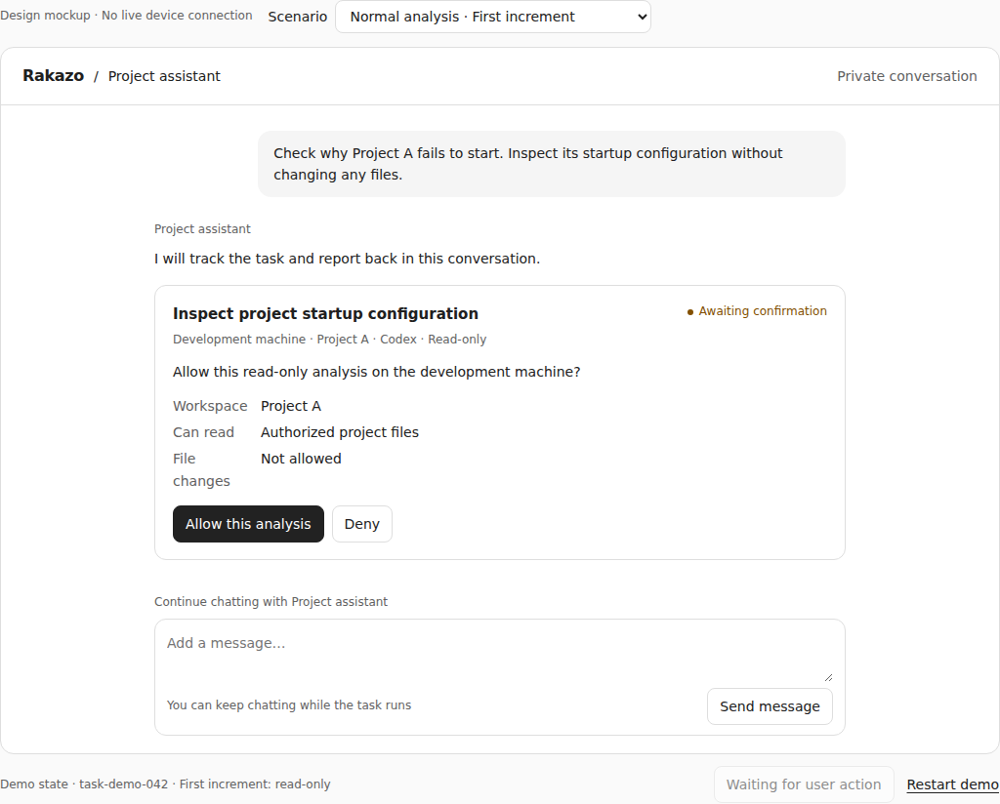
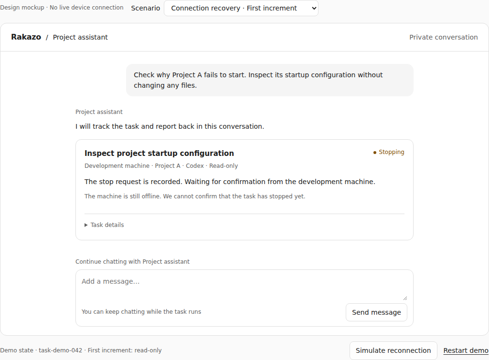
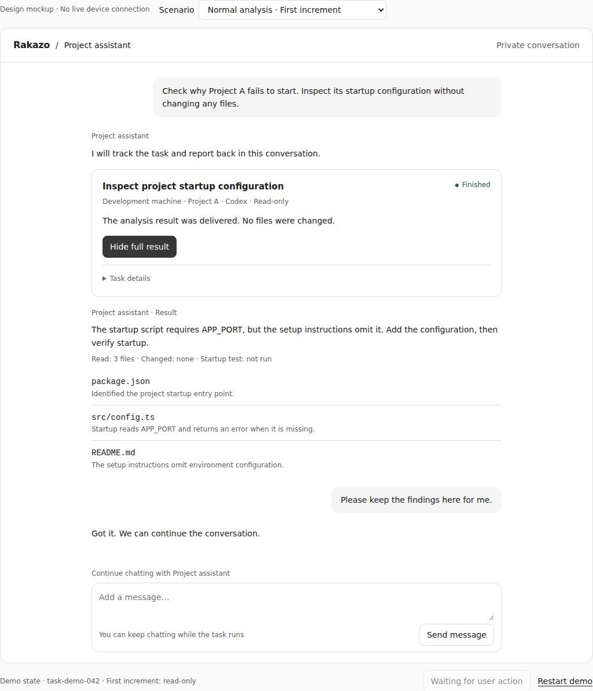
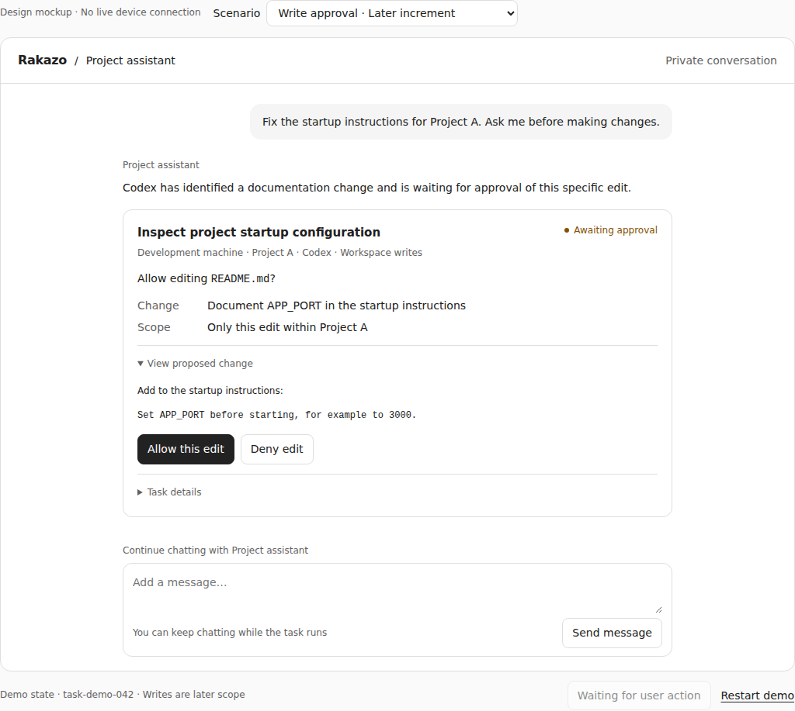
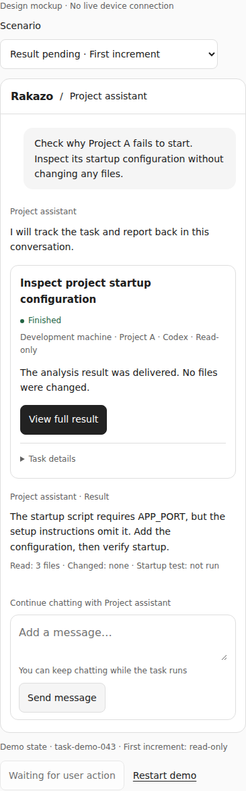

# Interaction design: delegated native-agent tasks

**Design mockup only.** All content is fictional. These screens do not demonstrate live remote execution, filesystem confinement, or working native approvals.

[Architecture](architecture.md) · [Download the interactive prototype](prototype.html) · [Local prototype checks](verification.json)

## Interaction goal

Keep the user in the original bot conversation. Make the machine, workspace, runtime, permission scope, and task state visible. Preserve ordinary chat while the delegated job runs. Expand technical details and full results on demand instead of adding a task dashboard or streaming every tool log into the conversation.

The mockup follows the existing quiet chat-and-card approach. Its standalone CSS is for reviewing behavior; production should use Rakazo's shared components, tokens, translations, and native mobile presentation.

## Walkthrough

| Scenario | Prototype interaction | Expected behavior |
|---|---|---|
| Normal analysis | Delegate to Codex, allow the analysis, then simulate execution completion and result delivery | Show target and permissions before launch; result content appears only after delivery. |
| Connection recovery | Select Connection recovery, then simulate reconnection | The same task resumes observation, retaining its identity; no rerun button. |
| Cancellation | Select Stop a task, request stop, then simulate host confirmation | Show Stopping until the host confirms termination. |
| Result pending | Select Result pending, then simulate delivery | Separate completed execution from available results; do not rerun to recover output. |
| Write approval, later scope | Inspect the proposed change, then allow or deny | Name the file, change, and permission for that specific request. Clearly label this as a later increment. |

The scenario selector and simulation controls sit outside the product frame. They are review controls, not proposed product features. Real transitions would come from authorized server and execution-host events.

## Entry and approval

After the user asks for project analysis, the bot offers delegation to the already registered target. With one target, show it directly rather than adding a one-option picker. Operator registration remains deployment configuration in the first increment.

The illustrated launch flow uses **Ask** mode. Auto/Never ask must retain their actual existing policy; the design does not require an extra confirmation in every mode. Target and permission information remains visible. Missing configuration or an offline target must not be presented as ready for immediate execution.

## State contract

| State | User-facing meaning | Available action |
|---|---|---|
| Ready | The registered environment can accept this delegated task | Delegate to Codex |
| Awaiting confirmation | Target, readable scope, and no-write restriction are visible | Allow this analysis / Deny |
| Running | A real execution phase is known; no invented percentage or ETA | Stop task / Task details / Continue chatting |
| Connection lost | The original job may still be running; status is being reconciled | Request stop / Task details |
| Stopping | Cancellation is recorded but not yet confirmed | Continue chatting / Task details |
| Stopped | The host confirmed that the task stopped | Task details |
| Execution finished · Result pending | Execution ended but output is not yet available here | Continue chatting / Task details |
| Finished | A persisted result is available | View full result |
| Awaiting write approval, later scope | A concrete native edit request needs a decision | Allow this edit / Deny edit |

An offline stop is an important combined state: reconnection alone does not confirm cancellation. The UI must remain Stopping until it receives the corresponding host confirmation.

## Results and continued chat

The result distinguishes findings, files read or changed, and verification that was not performed. A successful process exit is not proof that the requested fix works. Details include task identity and connection state; the main conversation does not expose queues, leases, or transport configuration.

Ordinary follow-up messages remain available. In the prototype they neither change the accepted task nor resume a native session. Changing the goal or scope requires explicit intent and appropriate authorization. Native-session continuation is outside the first increment.

## Later write approval

Show the affected file, the proposed change, and the scope of this particular request. Provide explicit allow and deny actions; do not preselect permanent authorization. Approval must be bound to the real native operation and expire when that operation becomes invalid.

Denying the request prevents that edit. Cancelling after an approved edit starts is different: stopping the process does not roll back changes already made, and the result must disclose partial or uncertain modifications.

## Mobile and accessibility

Use a single conversation column. Let the title, status, and actions wrap naturally. Keep essential actions available without hover and use touch targets of at least 44 px. Follow the active appearance, pair status color with text, retain native keyboard controls, and announce meaningful state changes politely.

## Validation limits

The local prototype checks exercise launch, continued chat, demo-state reload, cancellation pending across reconnection, result delivery, approval/denial, empty-input feedback, narrow layouts, and dark appearance. The prototype's reload state is local browser storage, not a backend durability test. Responsive-browser screenshots are not native mobile app acceptance.

Real remote-process cancellation, filesystem access boundaries, approval expiry, reordered events, revoked targets, and cross-user access must be implemented and tested against the architecture contract. The mockup does not cover every failure state.
